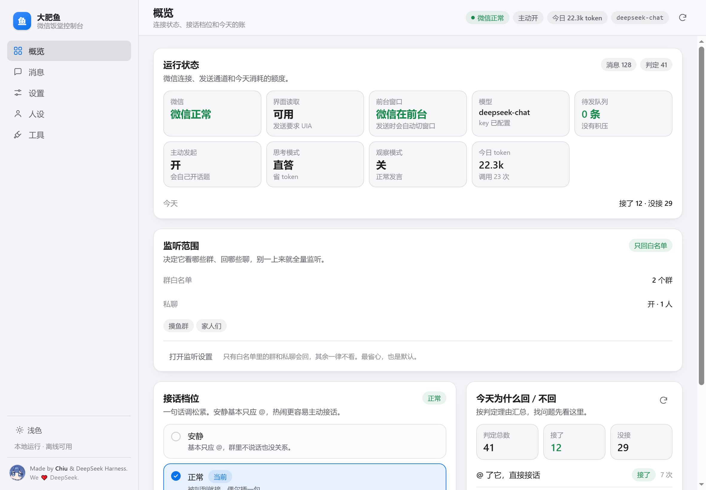
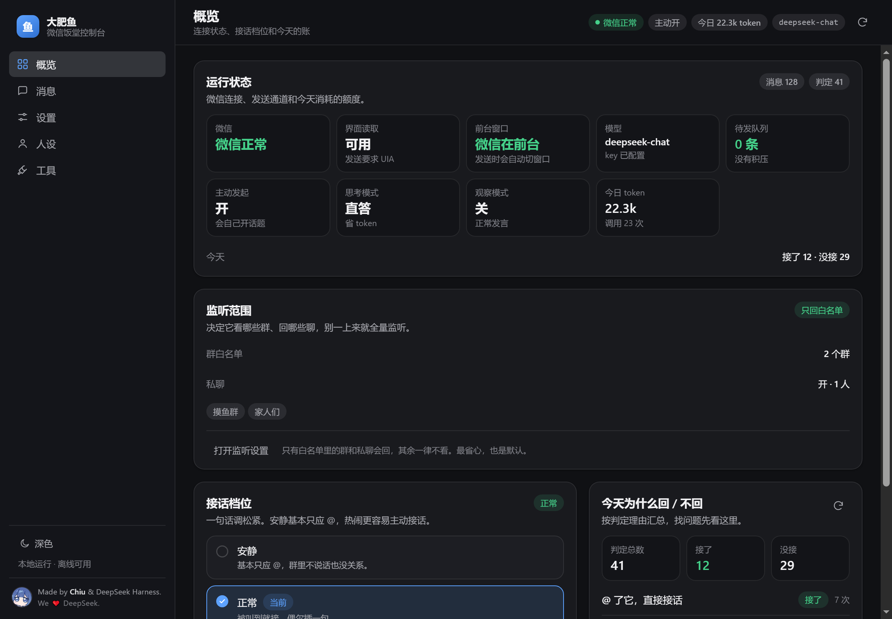
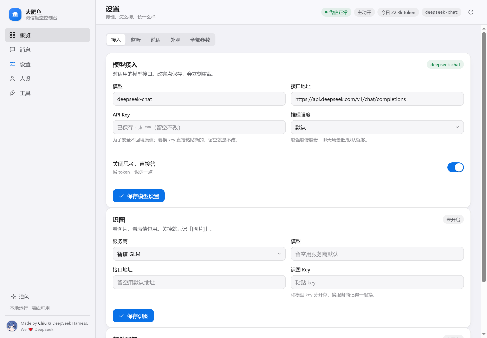

<div align="center">

# 大肥鱼 · Windows 微信机器人控制台

**给一台常开的 Windows 电脑、一个微信小号、一个 DeepSeek API Key，它就在群里替你说话。**

[](LICENSE)
[]()
[]()
[]()



</div>

---

## 它是什么

大肥鱼是一个跑在 **Windows 桌面微信**上的 AI 助手。它用系统自带的界面自动化（UIA）读微信窗口、用数据库轮询收消息，然后在**你指定的群和私聊**里像正常人一样接话、答问题、陪聊、发图。

它不是「公众号机器人」，也不是「协议登录」那一路：**它没有逆向微信协议，没有用第三方扫码登录**，就是老老实实地读写你已经登录的那个微信窗口。代价是必须有一台 Windows 电脑开着微信，好处是不碰账号密码、不改客户端、随时能一把关掉。

## 截图

| 浅色 | 深色 |
| --- | --- |
|  |  |

设置页长这样（所有配置项中文说明 + 一键档位，不用改配置文件）：



> 截图用演示数据渲染，不是真实聊天记录。

## 亮点

### 1. 会「主动接话」，不只是被 @ 才动

大多数机器人是被动的：你叫它，它答。大肥鱼每条群消息都会先**打分**，觉得这话题自己能接得上，就主动插一句；群里冷场太久了，它还会自己起个头（时间、概率、每天次数都能设）。不想它乱说话？一键切「安静档」或打开观察模式。

### 2. 判分 + 门禁：先想「该不该说」，再想「说什么」

每条消息判 0–10 分，过线才回。此外还有一堆硬限制叠在上面：每群并发、每小时条数、两条之间的最小间隔、主动插话的窗口次数、私聊冷却、连续说话轮数……这些都是为了防止它变成刷屏机器。判定理由会留在控制台里，随时能看到「刚才为什么不回」。

### 3. 人格、心情、记忆

- **人格**：`personas/base.md` 就是它的人设，纯中文，随便改，改完就换个人。
- **心情**：0–100 的心情值，被骂掉、被夸涨、时间久了会淡，心情低的时候它就懒得说话。
- **记忆**：群聊会记群里的梗和人，私聊记对方，还支持你在聊天里直接命令它记东西。
- **模式**：群里有人喊一句，它可以临时切「工作模式」「简洁模式」，过一阵自动切回来。

### 4. 能看懂群里发的东西

链接会去读标题和摘要再评论；图片和表情包需要打开识图（支持智谱 GLM 等），不开就只记一句「[图片]」；语音走本地 faster-whisper 转文字；微信的卡片消息会解析出卡片标题再判断要不要接。

### 5. 看门狗：崩了会自己爬起来

三层守护：后端心跳断了，`watchdog.py` 负责重启；进程被 Windows 的作业对象（Job Object）管着，关窗口时连子进程一起收走，不会留一堆僵尸 Python；连续发送失败达到阈值，机器人会主动自杀重启，而不是卡死在半死不活的状态。

### 6. 单文件控制台

整个网页控制台就是一个 `index.html`（样式、逻辑、图标全在里面，零外部依赖），后端是 FastAPI，只监听 `127.0.0.1`。断网也能用，因为它不连任何前端 CDN。

## 和市面上其他微信机器人比

| | wechaty 系 | ChatGPT-on-WeChat 这类 | **大肥鱼** |
| --- | --- | --- | --- |
| 接入方式 | 协议 / puppet / 第三方网关 | 公众号、企业微信、部分个人号协议 | **驱动真实的桌面微信窗口** |
| 需要服务器 | 通常要（Linux 也行） | 通常要 | **不需要，一台 Windows 就行** |
| 支持系统 | 跨平台 | 跨平台 | **仅 Windows 10/11** |
| 群聊主动接话 | 要自己写 | 一般只应答 | **内置判分 + 主动接话** |
| 说了不该说的话 | 靠 prompt 兜 | 靠 prompt 兜 | **分不够就不说，还有一堆硬门禁** |
| 可视化控制台 | 一般没有 | 部分有 | **单文件网页控制台** |
| 上手门槛 | 要会写代码 | 要会改配置、懂点部署 | **双击 bat，填个 Key** |
| 主要代价 | 协议风险、封号 | 部署麻烦 | **要一台常开电脑，发送时会抢一下前台** |

一句话：**wechaty 那一路是把微信「变成接口」，大肥鱼是把微信「当成一个人在旁边用」。** 前者更适合做服务，后者更适合自己电脑上养一个会说话的号。

## ⚠️ 风险与免责（请务必看完）

**1）账号风险，用小号。**
这类工具本质是自动化操作微信客户端，不符合微信的自动化规范，被限制功能甚至封号是有可能的。**别拿主号试**。用一个单独申请的小号，出问题不心疼。

**2）它会短暂占用前台窗口和鼠标。**
这是最容易被误会的一点，说清楚：

- **收消息不抢前台。** 收消息是读微信本地数据库 + 轮询，全程后台，你该干嘛干嘛。
- **发消息会抢前台。** Windows 的界面自动化（UIA）只能操作「当前在前面的窗口」里的控件，所以它要发消息时，会把微信窗口切到前台、把焦点给输入框、点「发送」，然后结束。
- **持续多久？** 正常一次 0.3–1 秒。如果微信被最小化或被别的窗口盖住，它需要先调出来，会多花一点时间。
- **什么时候发生？** 只有「它决定要回一句」的时候。观察模式、安静档、白名单之外——都不会触发。
- **怎么让它别烦你？**
  - 打开**观察模式**（只看不回，控制台一键）；
  - 用**白名单**或「只回被 @ 的」，别开全量；
  - 打开 `require_consent`，每次发送前都要你点确认；
  - 别在开会、剪视频、打游戏的时候开它；
  - 想彻底不动你的屏幕，就把它装在一台闲置电脑/副机上。

**3）AI 会胡说八道。**
它说的话不代表你。敏感场景（业务群、客户群、家长群）建议只开观察模式看日志，或者干脆别放进去。

**4）免责。**
本项目按 MIT 协议「按现状」提供，不承诺稳定、不承诺不被封号、不承诺回复质量。使用它产生的一切后果（账号、内容、法律责任）由使用者自负。请遵守微信用户协议与当地法律法规，不要用于骚扰、诈骗、刷单、批量营销等用途。

## 5 分钟跑起来

```text
① 装 Python 3.12（勾 Add python.exe to PATH）
② 双击  一键安装依赖.bat        ← 第一次几分钟，装完别关窗口
③ 双击  肥鱼饭堂.bat            ← 弹出控制台窗口
④ 控制台 →「设置 → 接入」→ 填 DeepSeek API Key → 保存
⑤ 控制台 →「设置 → 监听」→ 选「只回被 @ 的」或填群白名单
```

没有 Key 也能开起来（只是生成不了回复），控制台会顶一条黄条提醒你。完整步骤、坑、注意事项全在 **[使用教程.md](使用教程.md)**，卡住了看 **[FAQ.md](FAQ.md)**。

## 文档

| 文件 | 里面有什么 |
| --- | --- |
| [使用教程.md](使用教程.md) | 从申请 Key 到卸载的九步教程，给完全不懂代码的人 |
| [FAQ.md](FAQ.md) | 发不出消息、掉线、抢鼠标、token 花太多…… |
| [config.example.yaml](config.example.yaml) | 所有配置项，每一条都有中文注释 |
| [personas/base.md](personas/base.md) | 人格模板，改它就换人设 |
| [CHANGELOG.md](CHANGELOG.md) | 版本变更 |
| [docs/发布指引.md](docs/发布指引.md) | 维护者备忘：仓库描述、关键词、Release 怎么写 |

## 常见问题速查

- **它不回话** → 看控制台顶部的状态：微信没登录？白名单空了？判分没过线？
- **发不出去 / 待发队列堆积** → 微信窗口被最小化或被别的窗口挡住，把微信正常打开着。
- **鼠标被抢** → 见上面第 2 条；先开观察模式。
- **token 烧太快** → 关 `judge_enabled`（只认关键词）、缩小 `context_window`、开 `disable_thinking`。
- **掉线** → 微信自己掉线了它救不了，重新扫码登录后它会自己接上。

更多见 [FAQ.md](FAQ.md)。

## 目录结构

```text
dafeiyu-v1.0/
├── 肥鱼饭堂.bat            ← 双击启动（无控制台窗口）
├── 启动-带控制台.bat        ← 调试用，能看见报错
├── 一键安装依赖.bat         ← 第一次装依赖
├── app_window.py           ← 桌面窗口 + 进程守护
├── run.py                  ← 后端启动入口
├── watchdog.py             ← 心跳看门狗
├── config.example.yaml     ← 配置模板（全中文注释）
├── config.yaml             ← 你的配置（自动生成，别提交）
├── requirements.txt
├── assets/                 ← 图标、作者头像
├── data/                   ← 记忆库、表情包、涂鸦（运行时生成，别提交）
├── docs/screenshots/       ← 截图
├── logs/                   ← 日志（运行时生成）
├── personas/               ← 人设、心情、模式
│   ├── base.md
│   ├── state.md
│   └── modes/
├── src/
│   ├── channel/            ← 微信通道：收消息、发消息、UIA 自动化
│   ├── core/               ← 判分、策略、记忆、人格、流水线
│   └── web/                ← FastAPI + 单文件控制台
└── tools/                  ← 无窗口启动脚本
```

## 隐私与安全

- **数据不出本机**：聊天记录、记忆、判定记录全在 `data/bot.db`（SQLite），没有云端同步。
- **API Key 明文存在 `config.yaml`**：本地文件，别截图发人、别传到网盘、别提交到 git（`.gitignore` 已经排掉了）。
- **控制台只监听 127.0.0.1**：别人访问不到。把 `web.host` 改成 `0.0.0.0` 会暴露到局域网，别乱改。
- **日志里有聊天内容**：`logs/` 目录同理，发 issue 前记得打码。

## 许可与致谢

MIT License，见 [LICENSE](LICENSE)。

模型用 [DeepSeek](https://platform.deepseek.com/)；桌面窗口用 pywebview；微信自动化基于 UIA 与 wechatauto。

<div align="center">

**Made by Chiu & DeepSeek Harness. We ❤️ DeepSeek.**

</div>
