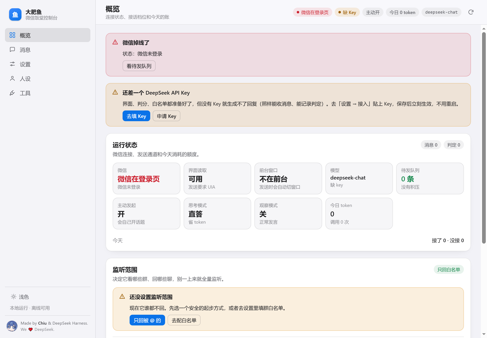

# 大肥鱼 · 使用教程

> 写给完全不懂代码的人。跟着一步一步做，中间不要跳步。
> 卡住了先翻 [FAQ.md](FAQ.md)，还是不行就去仓库提 issue，把 `logs\` 里的报错贴上来（记得打码）。

---

## 目录

1. [开箱前，先认清三件事](#一开箱前先认清三件事)
2. [第一步：申请 DeepSeek API Key](#二第一步申请-deepseek-api-key)
3. [第二步：弄一个微信小号](#三第二步弄一个微信小号)
4. [第三步：把小号养稳（实名与稳定期）](#四第三步把小号养稳实名与稳定期)
5. [第四步：装依赖、启动](#五第四步装依赖启动)
6. [第五步：首次配置](#六第五步首次配置)
7. [第六步：基础功能怎么用](#七第六步基础功能怎么用)
8. [第七步：高级设置逐项解释](#八第七步高级设置逐项解释)
9. [第八步：常见问题](#九第八步常见问题)
10. [第九步：更新与卸载](#十第九步更新与卸载)

---

## 一、开箱前，先认清三件事

**1. 它需要一台「常开的 Windows 电脑」。**
不是装在群里的云端服务，而是一个跑在你电脑上的程序。电脑关机 = 机器人下线。笔记本合盖休眠也一样。

最低要求：

| 项目 | 要求 |
| --- | --- |
| 系统 | Windows 10 / 11（64 位） |
| Python | 3.12（安装时勾 `Add python.exe to PATH`） |
| 微信 | Windows 桌面版微信，**并且一直保持登录** |
| 内存 | 8 GB 起（开了语音识别建议 16 GB） |
| 磁盘 | 3 GB 空闲 |
| 网络 | 能访问 `api.deepseek.com` |

**2. 它会**短暂**占用你的前台窗口和鼠标。**
发消息的时候，它要把微信窗口切到最前面、点输入框、点发送，大概 0.3–1 秒。收消息完全在后台，不抢。
所以：**别在你开会、剪视频、打游戏的时候让它干活**；先开「观察模式」看一天，确认它不烦人再放开。

**3. 用它有账号风险，所以用小号。**
这类工具是"自动化操作微信客户端"，不符合微信的自动化规范，被限制甚至封号都有可能。**不要拿主号试。** 出问题你只会心疼那个小号。

> 三条铁律：**用小号**、**先观察模式**、**白名单别乱开**。

---

## 二、第一步：申请 DeepSeek API Key

机器人"想事情"靠的是 DeepSeek 的大模型，所以要给它一个 Key（相当于电话卡）。

1. 打开 <https://platform.deepseek.com/>
2. 用手机号注册 / 登录。
3. 左边菜单找 **「API keys」**（有的版本叫「API 密钥」）。
4. 点 **「创建 API key」**，名字随便写，比如 `dafeiyu`。
5. 复制出来的那串 `sk-` 开头的东西。

> **只显示一次！** 关掉弹窗就再也看不到了，先粘到记事本里。丢了就重新建一个。

6. 充值。左边菜单找 **「充值」**，充个十块二十块就够玩很久——`deepseek-chat` 是便宜档，日常闲聊一个月花不了几块钱。
   - 不充值也能创建 Key，但调用会报"余额不足"。

**这个 Key 就等于你的钱包，不要发给任何人、不要截图、不要传到群里。** 它只填在你自己电脑上的配置文件里。

---

## 三、第二步：弄一个微信小号

**核心原则：单独一个号，不要用你的主号。**

### 方案 A：辅助注册（推荐，免费）

微信允许用一个"老号"辅助注册一个新号：

1. 手机微信退出登录（或者用另一台手机）→ 登录页 → **「更多」/「注册」**
2. 选 **「辅助注册」**（有时写作"通过已注册的微信号辅助注册"）
3. 按提示，用你的主号扫一扫 / 确认

**这里的坑：**

- **辅助号有门槛**：一般要求账号注册满半年以上、近期没有被封记录、当天辅助次数没超。不符合会直接提示"暂不支持"。
- **一个号辅助次数有限**，别拿去帮陌生人注册，会被判定为异常。
- 辅助注册出来的号**功能会受限**（比如不能立刻用微信支付、不能加太多人），这是正常的，养几天就好。
- 如果辅助注册一直不成功，别死磕，走方案 B。

### 方案 B：办一张便宜的手机卡（最省事）

- 运营商营业厅 / 网上都能办，最低档的卡一个月几块钱。
- 用这张卡注册一个全新微信号。
- 好处：干净、独立、以后小号没了也不影响你。

### 绝对不要做的

- ❌ 用主号当机器人号（封了就是社死）
- ❌ 买"已实名成品号"（来路不明，随时被找回）
- ❌ 同一个手机号反复注册注销（风控标记）

### 注册完之后

- 设置头像、昵称（**别用"机器人""AI""测试"这种名字**，越普通越好）。
- 加 2–3 个你自己的群，或者建一个只有你和主号的群当试验田。
- 先当正常账号用几天（见下一步）。

---

## 四、第三步：把小号养稳（实名与稳定期）

新号直接挂机器人，很容易被系统当成异常。花几天"养号"，后面省心得多。

### 1. 完成实名（可选但推荐）

- 微信 → 我 → 服务 → 钱包 → 按提示绑定银行卡完成实名。
- **建议绑一张不用的储蓄卡**，别绑工资卡。
- 实名的意义：账号权重更高、功能更全、被误判的概率更低。**机器人本身不碰你的钱**，它只读聊天记录、只发消息。

> 不想实名也能用，但受限功能多，风控更容易盯上它。

### 2. 稳定期（建议 3–7 天）

这期间**先别挂机器人**，就当普通账号用：

| 天 | 做点什么 |
| --- | --- |
| 第 1 天 | 换头像、改昵称、发几条朋友圈（真实的，别刷屏） |
| 第 2–3 天 | 在群里正常聊天、发发表情包、给别人点个赞 |
| 第 4–5 天 | 加几个好友、进一两个群、收发几次红包（小额） |
| 第 6 天以后 | 可以开始挂了，但**先开观察模式**跑一天 |

### 3. 挂上之后也别太猛

- 一开始只放 1 个群，条数限制调低（每小时 10 条以内）。
- 别 24 小时不间断说话，深夜让它闭嘴（`schedule` 里默认 00:00–08:00 安静）。
- 别在几十个大群里同时开——这是最容易被判定为营销号的行为。

---

## 五、第四步：装依赖、启动

### 1. 装 Python 3.12

1. 打开 <https://www.python.org/downloads/windows/>，下载 **Python 3.12.x** 的 64 位安装包。
2. 双击安装，**第一屏一定要勾上 `Add python.exe to PATH`**，然后点 `Install Now`。
3. 装完打开「命令提示符」（开始菜单搜 `cmd`），输入：

```bat
py -3.12 --version
```

看到 `Python 3.12.x` 就对了。没有的话重装一遍，注意勾 PATH。

### 2. 把文件夹放好

- 解压到**纯英文路径**，比如 `D:\dafeiyu`。
- **不要放在** `C:\Program Files`、桌面、OneDrive 同步目录里（权限和同步都会出问题）。

### 3. 装依赖（只做一次）

双击 **`一键安装依赖.bat`**。

- 会自动建一个 `.venv` 虚拟环境，然后从清华镜像下载依赖。
- 第一次要几分钟，窗口里滚一堆东西是正常的，**别关窗口**。
- 最后看到「装好了。下一步：双击『肥鱼饭堂.bat』」就成功了。

如果报错「不是内部或外部命令」，说明 Python 没装好或没进 PATH，回到第 1 步。

### 4. 启动

先打开微信并登录小号（**保持窗口开着，别最小化到托盘**），然后双击：

**`肥鱼饭堂.bat`**

几秒后会弹出一个窗口（标题「肥鱼饭堂」），里面就是控制台。第一次打开大概长这样：



> 顶上有黄条「还差一个 DeepSeek API Key」是**正常的**——还没填 Key。
> 红条「微信掉线了」说明微信没登录或者没开，去登录一下。

**窗口关掉 = 机器人停止。** 想让它一直跑，就让它开着，或者把窗口最小化（别关）。

> 出问题看不到原因时，改用 **`启动-带控制台.bat`** 启动，会保留一个黑窗口显示报错。

---

## 六、第五步：首次配置

控制台五个页面：**概览 / 消息 / 设置 / 人设 / 工具**。第一次只需配三处。

### ① 填 API Key

设置 → **「接入」** → 把 `sk-` 开头的 Key 粘进 **「API Key」** → 点 **「保存模型设置」**。

保存后 Key 会显示成 `已保存 · sk-****（留空不改）`，这是正常的（不回显原值，更安全）。以后要换 Key，直接粘新的进去覆盖。

### ② 选监听范围（**这一步最关键**）

设置 → **「监听」**，四种模式：

| 模式 | 意思 | 适合谁 |
| --- | --- | --- |
| **只回被 @ 的**（`at_only`） | 只有 @ 它、或者叫它名字时才回 | **新手首选** |
| **只回白名单**（`whitelist`，默认） | 只在你填的群里活动 | 想让它陪聊的群 |
| **全部监听**（`all`） | 所有群所有私聊都看 | 不建议，容易乱插话 |
| **全不回**（`off`） | 只看不说话（配合观察模式） | 想先攒数据 |

**建议顺序**：先选「只回被 @ 的」跑两天 → 觉得靠谱了，再把常聊的群名填进白名单。

群名要**一字不差**：打开微信，看群聊顶部的名字，复制过去。改过群名的群要重新填。

### ③ 认主（强烈建议）

人设 → **「主人」**：

- **主人昵称**：填你自己的微信昵称（或 wxid）。
- **称呼主人为**：默认「老大」。
- 保存后，只有你（主人）能用「记住 xxx」这类命令改它的记忆。

### ④ 跑一次自检

工具 → **「自检」** → 「开始自检」。五项检查（模型 Key、微信、界面读取、数据库、时段）全绿就说明通了。

想看它在群里怎么回、又不想打扰真人：工具 → **「模拟一条消息」**，填内容点发送，它走真实流程（判定、门禁、生成），结果发到测试群。

---

## 七、第六步：基础功能怎么用

### 概览页

- **运行状态**：微信连没连上、能不能发、今天回了多少条。
- **监听范围**：现在盯哪几个群。
- **接话档位**：`安静` / `正常` / `活泼` 一键切，不用改配置文件。
- **今天为什么回 / 不回**：按理由统计，调教它的第一手依据。老是"没接"，就把档位调活泼一点，或者把阈值调低。

### 消息页

- **实时消息**：最近 300 条它看到的微信消息。
- **待发队列**：发送失败的回复会先存着，微信窗口正常后会重试。**这里堆东西 = 发送有问题**（多半是微信被挡住了）。
- **最近判定**：每条消息的分数和理由。

### 人设页

- **基础人格**：就是 `personas/base.md` 的内容，直接在网页里改，改完保存，下一条消息生效。
- **主人与家人**：把常出现的人写进去，它说话会更准（"家人"列表来自它对联系人的记忆）。
- **人格文件路径**：一般不用动。

### 工具页

- **自检**：五秒看清哪个环节没接上。
- **模拟一条消息**：不打扰真人的测试入口。
- **回放**：把一个群某天的记录导出来看（只读，不会重发）。

### 在微信里能用的指令（发给它）

| 你发 | 它做什么 |
| --- | --- |
| `@它 在吗` | 被 @ 一定回 |
| `切工作模式` / `切简洁模式` | 临时换说话风格，默认 60 分钟后自动恢复 |
| `记住：老王喜欢喝美式` | **只有主人能用**，写进这个群的记忆 |
| 私聊它 | 私聊不受群白名单影响（但要在设置里给私聊开权限） |

---

## 八、第七步：高级设置逐项解释

大多数项都能在控制台「设置 → 全部参数」里找到；也可以直接改 `config.yaml`（**改完要重启**）。

> 控制台点保存会把 `config.yaml` 重写成不带注释的版本。想留着注释，就直接编辑文件、别在网页里点保存。

### 接话策略（最常调的几项）

| 项 | 默认 | 说明 |
| --- | --- | --- |
| `policy.score_threshold` | 7 | 打分门槛。**调低=更爱说话**（5 就很活跃），调高=更闷（9 基本只应 @） |
| `policy.judge_enabled` | true | 关掉后用关键词判断，省钱但会变笨 |
| `policy.observation` | false | **观察模式**：只看不接，只记日志。新手建议先开一天 |
| `policy.triggers` | 大肥鱼 / 鲸鱼娘 / 小鲸鱼 / deepseek | 命中就当在叫它，直接接 |
| `policy.context_window` | 20 | 判分时看最近几条消息。调小省钱，调大更懂上下文 |
| `policy.max_reply_chars` | 120 | 单条回复最长多少字 |
| `policy.max_consecutive_turns` | 3 | 最多连着说几句，防止自己跟自己聊 |

### 频率限制

| 项 | 默认 | 说明 |
| --- | --- | --- |
| `budget.per_hour` | 30 | 每小时最多回几条 |
| `budget.min_gap_seconds` | 3 | 两条之间至少隔几秒 |
| `policy.interject_limit` | 2 | 5 分钟内最多主动插话几次 |
| `policy.reply_window_limit` | 5 | 10 分钟内最多回几次 |

### 作息与主动开口

| 项 | 默认 | 说明 |
| --- | --- | --- |
| `schedule.quiet_start` / `quiet_end` | 00:00 / 08:00 | 安静时段，基本不主动说话 |
| `schedule.active_bonus` | 2 | 活跃时段判分加分 |
| `schedule.quiet_allow_at` | false | 安静时段被 @ 了要不要破例回 |
| `proactive.enabled` | true | 会不会自己起话头 |
| `proactive.idle_minutes` | 90 | 群里安静多久它才可能主动开口 |
| `proactive.daily_limit` | 2 | 每天最多主动说几次 |

### 心情

| 项 | 默认 | 说明 |
| --- | --- | --- |
| `mood.start` | 50 | 初始心情（0–100） |
| `mood.insult_delta` | -18 | 被骂掉多少 |
| `mood.praise_delta` | 10 | 被夸涨多少 |
| `mood.quiet_below` | 15 | 低于这个值就懒得说话 |

### 表情包 / 识图 / 语音

- **表情包**：图片放进 `data/memes/<包名>/`，然后在 `memes.packs` 里写包名、`memes.enabled: true`。默认关。
- **识图**：`vision.enabled: true` 并填一个识图服务的 Key（默认支持智谱 GLM）。不开的话，别人发图片它只会记「[图片]」。
- **语音**：`asr.enabled: true`，第一次会从 hf-mirror 下载一个语音模型（几百 MB）。不想下就关掉。

### 守护（一般不用动）

| 项 | 说明 |
| --- | --- |
| `supervisor.*` | 心跳断了自动重启后端（默认 120 秒没心跳就重启） |
| `watchdog.max_send_failures` | 连续发送失败 5 次就自我重启 |

---

## 九、第八步：常见问题

详细的在 [FAQ.md](FAQ.md)，这里先给四条最常见的。

**Q1：它不说话。**
按顺序查：① 微信登录了吗（概览页顶部状态）② 监听范围是不是空的 ③ 那句话在群里是不是没 @ 它、也没叫它名字 ④ 消息页 → 最近判定，看分数和理由（"跟别人说话，不接" 就是它故意的）⑤ Key 填了吗、余额够不够。

**Q2：发不出去，待发队列越堆越多。**
99% 是**微信窗口被最小化或被别的窗口盖住**。把微信正常打开放在那儿，别最小化到托盘。还不行就重启机器人。

**Q3：鼠标被抢 / 光标乱跳。**
正常现象：它在发消息。缓解办法——开观察模式、只用白名单、别在忙的时候开、把它装到另一台电脑。

**Q4：token 花太快。**
关掉 `judge_enabled`（改成只认关键词）、把 `context_window` 从 20 调到 8、确认 `disable_thinking: true`（关闭思考）、把 `policy.observation` 打开（只判不生成）。

---

## 十、第九步：更新与卸载

### 更新到新版本

```text
① 关掉机器人窗口（任务栏右下角也可以确认一下没有残留）
② 备份两个东西：config.yaml 和 data 文件夹（你的记忆全在这）
③ 下载新版本，解压到一个新文件夹
④ 把备份的 config.yaml 和 data/ 复制进新文件夹，覆盖
⑤ 重新双击「一键安装依赖.bat」（依赖可能有变化）
⑥ 双击「肥鱼饭堂.bat」
```

> 直接覆盖旧文件夹也行，但**先备份**。项目没有自动更新，也不会偷偷联网。

### 卸载 / 彻底删干净

```text
① 关掉机器人窗口
② 打开任务管理器，确认没有 python.exe / pythonw.exe 还在跑（有就结束掉）
③ 删掉整个文件夹
```

就这些。它**不写注册表、不装服务、不开机自启**（除非你自己建了快捷方式）。微信聊天记录不在这个文件夹里，删了不影响你的微信。

### 暂时不想让它说话

不用卸载，两种办法：

- 控制台 → 设置 → 监听 → 选 **「全不回」**；
- 或者直接关掉窗口。

---

<div align="center">

**Made by Chiu & DeepSeek Harness. We ❤️ DeepSeek.**

</div>
